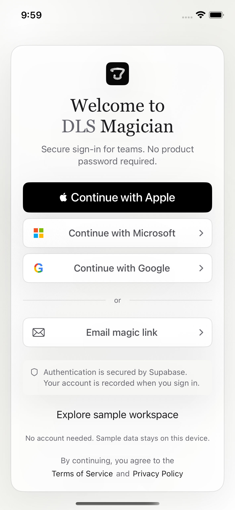
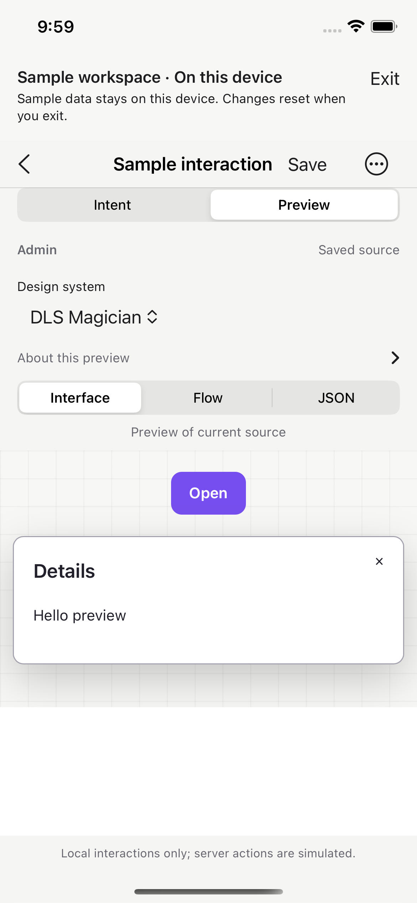
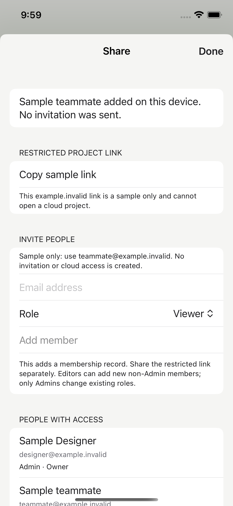

# Apple sign-in and local sample review candidate

Base: native TestFlight Build 11, `8e15cdcf54077b605330a921164fa1a916237f48`.
Review branch: `review/apple-signin-demo-20261011`.
This increment is for PM/Design review before promotion to the existing Cloud build branch. No Cloud run or App Store submission is requested by this branch.

## Scope

Adds the official native Apple sign-in control and entitlement, plus a visible “Explore sample workspace” entry on login, loading and connection-failure screens. It reuses the Build 11 editor, prototype interaction, Flow/JSON, design systems and collaboration interfaces. Existing gradients and hat assets are unchanged.

The candidate was reconstructed directly from Build 11. It does not contain the store-safety branch's deletion backend/journal/recovery files, comment-safety service models, report/block controls or test fixture changes. The already-unavailable “Review account deletion” Account entry was removed. Existing Build 11 deletion recovery contracts remain unchanged; this is not a claim of account-deletion or moderation readiness. No backend, Web, Android, Chrome, CI workflow or production data changes are included.

## Auth review

- `SecRandomCopyBytes` supplies a fresh 256-bit nonce per Apple attempt. Apple receives its SHA-256 hash; Supabase receives the raw nonce with the identity token. UUID state binds the native credential to the pending attempt; future/expired (10-minute), mismatched and replayed attempts fail.
- One active sign-in/exchange at a time. The native request is consumed before suspension, including terminal error paths. Cancellation is handled by the Apple sheet; an in-flight token exchange cannot be bypassed by the generic cancel action. Malformed native callbacks release the login attempt so retry remains possible.
- Missing/non-UTF8/empty identity tokens are rejected. Cryptographic token validity, audience and nonce validation are delegated to Supabase's ID-token endpoint via pinned Swift SDK 2.55.3; no client-decoded JWT is trusted as an authenticated session.
- Auth transport remains HTTPS to the exact configured Supabase host and `/auth/v1/` path, without redirects, cookies or URL cache. Existing session-generation and exchange-draining sign-out protections remain. Existing Microsoft/Google/email PKCE callback code is unchanged.
- Apple App ID capability and Supabase Apple ENABLED with Client IDs `design.zhenli.dlsmagician` were verified previously. No credential is embedded or logged.
- Actual Apple authorization, hide-my-email, returning login, cancellation and subsequent backend workspace bootstrap still need a signed-device test. Unit/UI checks here do not claim real Apple identity verification. A relay email can represent a different account; no automatic account linking or access to existing projects is promised.

## Sample-data isolation and reset

A separate AppModel uses an in-process actor with an explicit API transport override and no network fallback. Requests require its unique sample bearer and exact origin; unsupported routes/credentials/origins fail. Sample IDs never use production project IDs. Cloud auth callbacks and sign-out are not applied to this model.

Projects and drafts are memory-only. Closing marks both stores closed before future writes can succeed, erases sample state, and removes its separate preferences suite. A new demo uses new IDs and fresh state. A late draft write after close is rejected. The normal account's draft store, preferences and Keychain are not cleared. Sample share accepts only `@example.invalid`, sends no invite, grants no cloud access, and copies an explicitly nonfunctional example.invalid link. Local HTML preview retains Build 11's nonpersistent data store, restrictive CSP and navigation rejection.

The visible banner identifies sample mode and reset behavior. Exit needs confirmation. This mode is available in Release; DEBUG fixture arguments are not a reviewer entry.

## PM/Design walkthrough

1. On login, check Apple placement, retained provider choices, gradient/hat branding and the visible sample entry.
2. Tap **Explore sample workspace**, open **Sample interaction**, edit Intent and Save.
3. In Preview, tap Open to show Details; inspect Flow, JSON and design-system choices.
4. Create a workflow and use Share with `teammate@example.invalid`; add/resolve/reopen a sample comment.
5. Exit, confirm reset and re-enter; no previous sample edits should remain.

See screenshots in this folder. Images come from this candidate's actual simulator UI tests with synthetic content; they are not mockups.

## Validation and promotion gate

**46 unit tests and 10 UI tests passed, zero failures**, in `apple-demo-candidate-full.xcresult`. The original 8 UI tests and both new sample tests all passed. A separate **Release iphoneos arm64 build succeeded with signing disabled**. These are local results, not an installable signed device build. `verification.json` lists each passed case and evidence hashes; `tested-source-sha256.txt` fingerprints the exact native sources tested. Full original Build 11 UI coverage is retained, plus two sample UI workflows. The only live request in the login UI test reads public configuration; no real sign-in or production write is performed.

Do not promote until PM/Design review is complete. Cloud allowance for the future step is at most the user-authorized remaining 20m50s with no added cost; this local preparation consumes none. The existing Cloud workflow listens to `native/dls-swiftui-20261010`, not this review branch. Do not manually trigger a duplicate build.

Apple's capability change may require an updated provisioning profile. No credential/profile was created during this candidate preparation. Before a future signing step, verify reuse is possible; if a new profile, credential or expanded permission is required, stop for exact approval. No App Store review submission is authorized here.

## Screenshots

### Apple login and public sample entry

### Clearly labelled sample preview

### Local sample sharing

